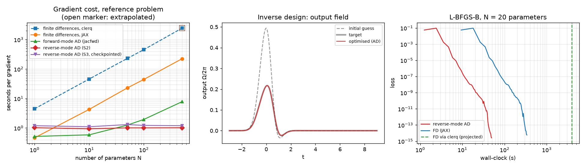
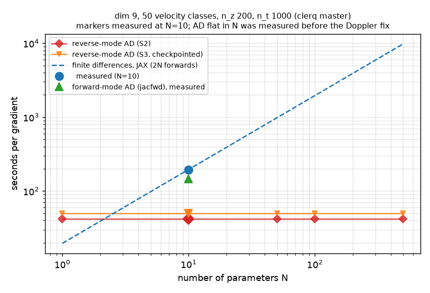

Requires the `jax` extra: `pip install 'clerq[jax]'`. See
[`AutodiffPropagation`](../api/autodiff.AutodiffPropagation.qmd) for the API.

This page records what was measured when the differentiable backend was prototyped, and the limits
of those measurements. The numbers come from a prototype branch (`spike/differentiable-backend`),
not from the released code, and the prototype and the released backend share the same design but
not the same source.

::: {.callout-warning}
## Read these as order-of-magnitude evidence
All timings are CPU-only, float64, on one shared Apple M1 Max, mostly best-of-2 or best-of-3 with no
confidence intervals. No GPU was available. The ratios (gradient cost over forward cost, autodiff
over finite differences) are the portable part; absolute seconds are not.
:::

## What was checked

- The JAX propagator reproduces `PropagationSolver.solve()` to 1e-10 or better on five systems
  (2, 4, 9, 9 with linear polarisation, and 16 levels), including velocity classes.
- Reverse-mode gradients agree with fixed-step finite differences (1.7e-8) and with finite
  differences through clerq itself (1.3e-7 for a two-level medium, 1.1e-7 for 9 levels with 50
  velocity classes).
- A gradient is the exact gradient of clerq's *discretisation*, so it inherits clerq's modelling
  and z-step error.

## Cost of a gradient

One reverse-mode gradient costs about 4 to 6 forward solves, whatever the number of parameters.

Two-level reference problem (200 z steps, 1000 time steps, one velocity class). One forward solve
takes 0.21 s in JAX and 2.25 s in clerq. Seconds per gradient (best of 3):

| Parameters | Reverse AD | Forward AD | Finite differences (JAX) | Finite differences (clerq) |
|-|-|-|-|-|
| 1 | 1.0 | 0.5 | 0.5 | 4.5 |
| 10 | 0.9 | 0.6 | 4.3 | 46 |
| 50 | 1.0 | 1.3 | 23 | 230 |
| 100 | 1.0 | 2.0 | 44 | 455 |
| 500 | 1.0 | 7.8 | 223 | 2443 (extrapolated) |

- Reverse mode beats finite differences from about 3 parameters, and forward mode from about 40 on
  this small problem. Forward mode is strongly size dependent: on the 9-level, 50-class problem it
  was much slower than reverse mode already at 10 parameters.
- Most of the speed-up over clerq comes from the compiled forward pass (10x for the two-level
  problem, about 165x for 9 levels and 50 classes), not from autodiff. The like-for-like comparison
  is against finite differences through the same JAX code: 44x to 47x at 100 parameters.

## Memory

Plain reverse-mode through the z scan stores every step, so its memory is set by the solver's
`max_steps` and not by the problem. Checkpointing removes that dependence.

At the largest configuration tried (500 z steps, 2000 time steps, 9 levels, 50 velocity classes) the
working memory was 5.6 GiB without checkpointing and 75 MiB with it. Checkpointing costs roughly
20% more time.

## Inverse design

Recovering 20 pulse-basis coefficients with L-BFGS-B took 49 s using autodiff gradients, against
339 s using finite differences through JAX and about 65 minutes projected through clerq. The target
was planted, so it is reachable by construction and the landscape is benign: this shows gradient
quality and cost, not a hard design problem.

## Practical notes

- **Validate against fixed-step finite differences.** Finite differences through an adaptive solver
  are noise-limited (error floors near `rtol / h`), so a gradient check against them can disagree
  by orders of magnitude when the gradient is right. Use `n_steps=` with a step count that does not
  divide the output grid.
- **Avoid commensurate fixed steps.** With diffrax 0.7, fixed steps that land exactly on output
  times can give wrong reverse-mode gradients. clerq raises an error for this case.
- **Resolve the z march.** An insufficiently fine `z_steps_inner` at high optical depth makes the
  march unstable and the energies meaningless; this is a property of the propagation scheme, not
  of autodiff.
- Recompilation costs 1 to 5 s per new array shape or loss function. Pass the same loss object
  between calls.

## Not yet established

GPU performance; counter-propagating fields; dense (non-single-element) dissipators at scale;
stiff regimes; systems above 16 levels; and any physically motivated design problem with a
non-planted target.
