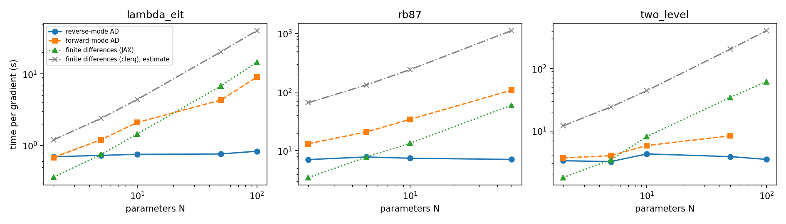
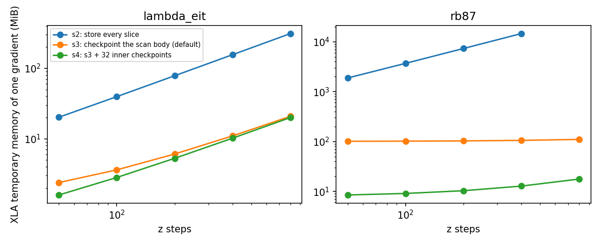

Requires the `jax` extra: `pip install 'clerq[jax]'`. See
[`AutodiffPropagation`](../api/autodiff.AutodiffPropagation.qmd) for the API.

This page records measurements of the released `clerq.autodiff` (0.14.0): what a gradient costs, how much
memory it needs, how accurate it is, and what it buys on a design problem. The harness that produced
every number is in `benchmarks/autodiff/` (with the raw results in `benchmarks/autodiff/results/`), so
they can be reproduced and rerun on other hardware.

::: {.callout-warning}
## One machine, CPU only
All timings are on one Apple M1 Max (10 cores, 64 GB, macOS 26.6.2) on AC power, CPU only, Python 3.14.4,
JAX 0.11.2, diffrax 0.7.2. Other applications were running, so the one-minute load average was
2 to 8 (median 3 to 5) during the runs; the runs of different methods are interleaved so that drift
affects them alike. The cost cells are the median of 7 repeats after warm-up (5 in the before-and-after
comparison, 3 for the slowest), with a bootstrap 95% interval of the median in the harness output; the memory and
compile-time cells are the best of two or three calls in a fresh process. No GPU was used, and the ratios (gradient
cost over forward cost, autodiff over finite differences) are the portable part; absolute seconds are not.
:::

## The cost of a gradient

A reverse-mode gradient costs about six forward propagations, whatever the number of parameters. The
parameters here are the coefficients of a free-form probe control (a Gaussian basis, see
[`clerq.autodiff.controls`](../api/autodiff.controls.gaussian_basis.qmd)), so `N` can be varied freely.

| system | forward (s) | reverse (s) | reverse / forward | at N = 50: forward-mode (s) | finite differences, JAX (s) | finite differences, clerq (s, estimated) | reverse speed-up over JAX / clerq |
|-|-|-|-|-|-|-|-|
| two-level, 1001 × 200 | 0.68 | 3.9 | 5.7 | 8.4 | 34.6 | 205 | 8.9x / 53x |
| lambda, 3 levels, 201 × 60 | 0.13 | 0.76 | 5.8 | 4.3 | 6.8 | 20.4 | 8.9x / 27x |
| Rb87, 11 levels, 11 classes, 201 × 50 | 1.18 | 7.1 | 6.0 | 108 | 60 | 1130 | 8.4x / 158x |

At N = 100 (two-level and lambda) the speed-up over finite differences through JAX is 17.7x and 17.6x, and
over clerq 116x and 48x.

- **What the finite differences are.** Forward differences, `N + 1` evaluations, through the compiled
  propagation. Central differences cost twice as much, which doubles every speed-up here.
  The finite differences through clerq are an *estimate*: `N + 1` times the measured time of one
  `PropagationSolver.solve()` (4.0 s, 0.40 s and 22 s for the three systems), not a measurement of that
  many solves.
- **When reverse mode wins.** It costs the same as finite differences through JAX at about `N = 5`, and
  is faster from `N = 10` (1.8x to 1.9x on all three systems).
- **Forward mode** (`mode="forward"`) was never faster than reverse mode: equal at `N = 2` on the lambda system
  and slower elsewhere (for example 13 s against 7 s for Rb87 at `N = 2`), and its cost grows with `N`. It was skipped for the two-level
  system at `N = 100`, where it would have taken over two minutes.
- **First call.** The first call includes compilation: a forward propagation takes 1.4 to 2.4 s the first
  time and the reverse-mode gradient 5.5 to 12 s, against steady-state times of 0.13 to 1.2 s and
  0.74 to 7.5 s. A new array shape or loss function recompiles, so pass the same loss object between calls.

## Memory

Plain reverse mode through the z scan (strategy `s2`) stores every slice, so its memory grows with the number of
z steps and of velocity classes. The default (`s3`) recomputes a slice on the backward pass and `s4` also limits the
solver's inner checkpoints (here to 32). The figure shows the temporary memory XLA reports for one
compiled gradient.

For Rb87 with 11 classes and 400 z steps, `s2` needs 14.3 GiB, `s3` 105 MiB and `s4` 13 MiB; at 800 z steps
`s3` needs 110 MiB and `s4` 18 MiB (`s2` was not run). For lambda at 800 steps it is 312 MiB, 21 MiB and 20 MiB.
Against the number of classes (Rb87, 100 z steps, 1, 11 and 25 classes): `s2` 347, 3698 and 8391 MiB; `s3` 11, 102
and 229 MiB; `s4` 2, 9 and 19 MiB. Checkpointing costs time: the steady-state gradient is about 20% slower
with `s3` than with `s2` and 26% to 39% slower with `s4` (Rb87, 100 z steps, 11 classes: 15.0 and 15.8 s
against 12.5 s; lambda at 100 z steps: 1.28 and 1.46 s against 1.05 s).

The peak resident set of the process also includes JAX and compilation, about 380 to 600 MiB above the
baseline for `s3` and `s4` whatever the problem, so the XLA figures are the ones that separate the strategies.

## Accuracy

| system | N | fixed steps | field error against `solve()` | AD against finite differences | forward against reverse | adaptive against fixed-step AD |
|-|-|-|-|-|-|-|
| two-level | 10 | 2003 | 2.5e-4 | 8.0e-9 | 8.5e-14 | 2.5e-5 |
| lambda | 10 | 2003 | 8.9e-8 | 2.3e-12 | 1.1e-16 | 1.9e-7 |
| Rb87, 11 classes | 6 | 1009 | 3.6e-4 | 5.4e-13 | 6.5e-16 | 4.8e-8 |

(The Rb87 case is smaller than the others because a fixed-step reference with 11 classes is slow.)

- The gradient is the exact gradient of the discretised problem: it agrees with central finite differences on a
  fixed-step solve to 8e-9 or better (best of four step sizes: the two-level problem needs steps of 1e-7 or
  smaller because its loss is very nonlinear), and forward and reverse mode agree to 1e-13 or better.
- The propagated field agrees with `solve()` to 2.5e-4 of the peak for the two-level problem and 3.6e-4 for Rb87 at the
  grids used here, and to 9e-8 for the lambda problem. We did not isolate the cause of the two larger differences, and the
  error did not fall steadily when the time grid was refined for the two-level problem.

## A design problem

The memory problem in [the research notes](https://github.com/tpogden/clerq/blob/master/research/autodiff-notes.md):
store a probe pulse in a Doppler-broadened lambda medium (11 classes, effective optical depth about 25) with the
coupling field off, and maximise the energy retrieved afterwards. A 5-parameter baseline (a super-Gaussian probe and
two coupling amplitudes) searched with Nelder-Mead is compared with a free-form design of 44 coefficients by gradient
descent (Adam).

- A 44-parameter gradient took 36 s with reverse mode against 279 s with forward differences (one forward
  evaluation takes 6.2 s).
- The baseline reached 0.068 retrieved after 296 evaluations and 2261 s.
- The free-form design passed that value at step 23, after 1037 s, and reached 0.106 after 40 steps (1809 s). With
  finite-difference gradients the same 23 steps would take about 6400 s (an estimate from the measured gradient time).

This run was slower than earlier runs of the same problem on the same machine (a forward evaluation took 3.2 s in
earlier runs); we did not identify why. The ratios are within a run. It is one problem, one optical depth and
one Doppler width. Without Doppler broadening a tuned three-parameter baseline matched the free-form result in the research notes (0.469 against 0.460), so this
advantage should not be assumed for other problems.

## Cost of the decay-rate parameters

Adding `decay_rates` (pull request 361) changed how the decays enter the solver. Running the same cost tests on the commit
before it and the commit after it, back to back: reverse mode took 1.00 to 1.01 times as long, a forward propagation 1.00
to 1.02 times, and forward mode 1.00 to 1.08 times (the largest at the two-level and lambda systems with `N = 10`). The two
runs were sequential, so slow drift cannot be excluded.

## Practical notes

- **Validate against fixed-step finite differences.** Finite differences through an adaptive solver
  are noise-limited (error floors near `rtol / h`), so a gradient check against them can disagree
  by orders of magnitude when the gradient is right. Use `n_steps=` with a step count that does not
  divide the output grid, and compare at several step sizes.
- **Avoid commensurate fixed steps.** With diffrax 0.7, fixed steps that land exactly on output
  times can give wrong reverse-mode gradients. clerq raises an error for this case.
- **Resolve the z march.** An insufficiently fine `z_steps_inner` at high optical depth makes the
  march unstable and the energies meaningless; this is a property of the propagation scheme, not
  of autodiff.
- **Free-form controls need a smooth parametrisation.** One free value per time sample lets an optimiser
  exploit the time grid (see `clerq.autodiff.controls`).

## Not yet established

GPU performance; counter-propagating fields; dense (non-single-element) dissipators at scale; stiff regimes;
systems of more than 11 levels; the largest cells (nine levels with 50 velocity classes, and `s2` at 800 z steps for
Rb87), which were not run; and any finite-difference timing through clerq beyond the one-solve estimate.
