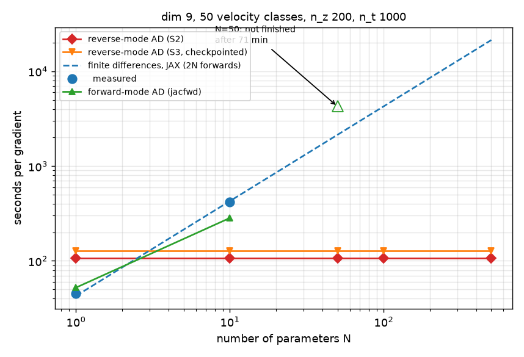
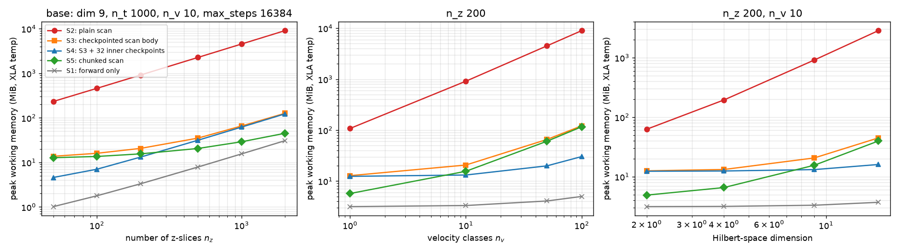

# Spike results: a differentiable Maxwell-Bloch backend for clerq

Branch `spike/differentiable-backend` (cut from `next` @ 178cb45). Design: [DESIGN.md](DESIGN.md).
Working log with every number and the dead ends: [PLAN.md](PLAN.md).

## Decision

**Build it.** The four pre-committed gates all pass, and the decision rule in DESIGN.md
("all four pass -> build the differentiable backend") applies.

Read the result as narrower than the design hoped in one respect and stronger in another:

- **Memory is not the story.** The design expected naive reverse-mode AD to run out of memory
  without checkpointing. It does not: the largest configuration we tried needs about 1 GB
  with checkpointing and 6.5 GB without. Checkpointing is worth having (17-75x less working
  memory, and independent of `max_steps`), but it is an engineering convenience, not what
  makes the problem tractable.
- **Speed and gradient quality are the story.** One reverse-mode gradient costs about
  5-6 forward solves regardless of the number of parameters. At N = 100 parameters that is
  **40-44x faster than finite differences through the same JAX code** on both problems we
  measured, and faster than finite differences through clerq as it stands by about 450x
  (two-level, measured) to several thousand x (dim 9 with 50 classes, extrapolated).
  The gradient is the exact gradient of the discretised solver and agrees with
  finite differences through clerq's own `PropagationSolver` to 1e-7 (two-level) and 5e-6
  (dim 9, 50 velocity classes), where 5e-6 is clerq's own FD noise floor.

## What was and was not established

Established (CPU, float64, Apple M1 Max, one field, co-propagating):

1. A JAX/diffrax `lax.scan`-over-z propagator reproduces `PropagationSolver` to ~1e-11 on four
   systems (dim 2, 4, 9, 16) including velocity classes, with the same scheme and z_steps.
2. Its reverse-mode gradients are correct (vs fixed-step FD, vs forward mode, vs FD through clerq).
3. Memory and time at sizes up to n_z = 500, n_t = 2000, dim 9, 50 velocity classes.
4. AD vs finite differences vs forward mode for N = 1 ... 500 parameters on two problem sizes.
5. A 20-parameter inverse-design problem solved end to end.

**Not** established: GPU performance (no CUDA device here), multi-field propagation,
counter-propagation, physically meaningful (non-planted) design objectives, dense or
non-single-element dissipators at scale, stiff regimes, anything beyond dim 16.

## Gates

| Gate | Criterion (as amended, see PLAN.md) | Result | Verdict |
|-|-|-|-|
| 1 Fits | S4 fits the stretch point (n_z 500, n_t 2000, dim 9, n_v 50) in <= 64 GB host | 992 MiB peak RSS (S4); 6.5 GiB even for plain scan | **Pass**, trivially |
| 2 Scales | peak memory at n_z = 2000 <= 4x that at n_z = 200; no-go if > 10x | S5 2.9x (slope 0.46); S3 6.1x (0.79); S4 9.4x (0.97); plain scan 10.0x (1.00) | **Pass for S5, between the bars for S3/S4** |
| 3 Correct | AD vs finite differences <= 1e-5 (f64) | 1.7e-8 vs fixed-step FD (two-level chain; all four systems < 1e-5); 1.3e-7 vs clerq-FD (two-level); 5.1e-6 vs clerq-FD (dim 9, 50 classes) | **Pass** |
| 4 Useful | AD beats FD at N = 50; >= 10x at N = 100; backward/forward <= 10x | two-level: 23x / 44x / 4.5x; dim 9, 50 classes: 20x / 40x / 5.0x (S2), 6.0x (S3) | **Pass** |

How to read Gate 2: S3 and S4 grow linearly in n_z with a very small constant (about
60 KiB per slice, 127 MiB at n_z = 2000), so a ratio test is a poor fit for them. S5 is sublinear
but is dominated by the stacked output array (n_z x n_t x 16 B = 32 MiB at n_z = 2000). The
qualitative claim, that checkpointing keeps memory far below plain scan, holds: 127 MiB vs
9085 MiB at n_z = 2000.

## Results

### Cost of one gradient vs number of parameters

Two-level reference problem (n_z 200, n_t 1000, one velocity class). One forward solve takes
0.21 s in JAX and 2.25 s in clerq. Seconds per gradient (best of 3):

| N | reverse AD (S2) | reverse AD (S3) | forward AD (`jacfwd`) | FD (JAX) | FD (clerq) |
|-|-|-|-|-|-|
| 1 | 1.0 | 1.2 | 0.5 | 0.5 | 4.5 |
| 10 | 0.9 | 1.1 | 0.6 | 4.3 | 46 |
| 50 | 1.0 | 1.3 | 1.3 | 23 | 230 |
| 100 | 1.0 | 1.2 | 2.0 | 44 | 455 |
| 500 | 1.0 | 1.2 | 7.8 | 223 | 2443 (extrapolated) |


Larger problem: j1_2_res (dim 9) with 50 velocity classes, n_z 200, n_t 1000. One forward solve
takes 21.4 s in JAX and roughly 30-50 minutes in clerq (9-15 s per z-slice, measured at
n_z = 4 and 8). Seconds per gradient:

| N | reverse AD (S2) | reverse AD (S3) | forward AD (`jacfwd`) | FD (JAX) |
|-|-|-|-|-|
| 1 | 109 | 131 | 52 | 45 (measured) |
| 10 | 107 | 124 | 284 | 419 (measured) |
| 50 | 107 | 130 | not finished after 71 min | 2140 (extrapolated) |
| 100 | 107 | 128 | not run | 4280 (extrapolated) |

Finite differences through clerq at N = 50 would need 100 forwards of 30-50 minutes each
(roughly 2-3.5 days) against 107 s for one AD gradient, a factor of about 1700-2800; this
is extrapolated from the measured per-slice cost and was not run.



Takeaways:

- Reverse-mode cost is flat in N: 5.0x forward (S2) and 6.0x (S3) at dim 9, 4.5x and 5.4x at
  dim 2. That is the per-evaluation tax the design assumed (3-5x), slightly above its range
  for the checkpointed variant.
- Speedup over JAX finite differences at N = 100: 44x (dim 2) and 40x (dim 9). The design
  guessed 25x.
- **Forward mode is strongly problem-size dependent.** On the two-level problem batching the
  tangents is almost free, and `jacfwd` beats reverse mode up to N of about 40. At dim 9 with
  50 classes it costs 1.3-1.4 forwards per tangent at N = 10 and was far worse at N = 50
  (not finished after 71 CPU-minutes, versus 107 s for reverse mode), so reverse mode wins from
  N of about 3. A production backend should keep both modes and choose by problem size.
- Most of the "vs clerq" factor is the compiled forward pass (10x on the two-level problem),
  not AD. The like-for-like AD comparison is against JAX finite differences.

### Memory

Compile-time working memory (XLA temp buffers) at the base configuration (dim 9, n_z 200,
n_t 1000, n_v 10), 96 cells over four axes; executed peak RSS agrees where measured.



| | S2 plain scan | S3 checkpointed body | S4 = S3 + 32 inner ckpts | S5 chunked scan |
|-|-|-|-|-|
| base (MiB) | 913 | 20.6 | 13.1 | 15.6 |
| n_z = 2000 (MiB) | 9085 | 127 | 123 | 45 |
| n_v = 100 (MiB) | 8984 | 122 | 30 | 117 |
| dim 16 (MiB) | 2850 | 45 | 16 | 40 |
| stretch point (MiB) | 5645 | 75 | 66 | 47 |
| stretch, peak RSS (MiB) | 6482 | 951 | 992 | not run |
| stretch, time (grad) | 300 s | 369 s | 391 s | not run |

Plain-scan memory is `max_steps` times the state size, not a property of the problem: at the
base configuration it is 234 / 328 / 463 / 913 MiB for `max_steps` = 1024 / 2048 / 4096 /
16384 (identical to DirectAdjoint), while S3 and S4 stay at 13-21 MiB. This independence
from a setting that cannot be known in advance is the robust argument for checkpointing.

### Inverse design

20 pulse-basis coefficients recovered by L-BFGS-B against a planted target on the two-level
reference medium:

| gradient source | iterations | gradient evaluations | final loss | wall-clock |
|-|-|-|-|-|
| reverse-mode AD | 37 | 43 | 2.6e-15 (from 5.6e-2) | 49 s |
| JAX finite differences | 35 | 40 | 5.9e-15 | 339 s (6.9x) |
| clerq finite differences | - | 43 (projected) | - | ~65 min projected (~80x) |

The coefficients are recovered to 7e-7 and the output field to 5e-8. The target is reachable by
construction and the landscape benign, so this shows gradient quality and cost, not a hard
design problem.

## Design hypotheses vs outcome

| DESIGN.md said | Measured |
|-|-|
| ~25x faster than FD at N ~ 100 despite a 3-5x per-evaluation tax | 40-44x; tax 4.5-6.0x |
| Naive AD stores n_z x n_t x dim^2 and "OOMs by n_z = 500" | False. Plain scan needs 5.6 GiB at the stretch point; its memory is `max_steps`-driven |
| `jax.checkpoint` on the scan body gives ~sqrt scaling | S3 is linear with a tiny constant (60 KiB/slice); sqrt needs the chunked scan (S5) |
| Inner `RecursiveCheckpointAdjoint`, not `BacksolveAdjoint` | Not tested (we never used backsolve); `RecursiveCheckpointAdjoint` gave correct gradients throughout, with one caveat below |
| Tsit5 is the right default | Confirmed; Dopri5/8 within ~25%, Bosh3 worse, Kvaerno5 unusable (problem is not stiff) |
| Doppler classes inside the scan carry vs outer `vmap` | Classes as a leading batch axis of one `diffeqsolve` (shared step controller); `vmap` of the Lindblad matvec was ~3x slower |
| `ForwardMode` as a low-N cross-check | Useful as a correctness check; competitive as a method only for small systems |
| Gate 1: <= 32 GB GPU | ~1 GB host RAM. GPU not measured |

## Findings that matter beyond the verdict

### 1. diffrax: wrong gradients when save times fall on fixed-step boundaries

With diffrax 0.7.2 / jax 0.11.2, `RecursiveCheckpointAdjoint` + `SaveAt(ts=...)` +
`ConstantStepSize` returns wrong reverse-mode gradients, with correct forward values, whenever an
integer number of fixed steps fits between output times. Error 3.5e-2 in a scalar-ODE repro
(`notes/diffrax_commensurate_repro.py`); in the Lindblad slice it appeared only under `jit`.
`DirectAdjoint` and `ForwardMode` are unaffected, and adaptive (PID) stepping does not hit it in
practice. It surfaced as "AD disagrees with FD and changes with the step count". The spike's
`check_fixed_step` raises on commensurate step counts. **Not yet reported upstream.**

### 2. Finite differences through an adaptive solver are noise-limited

The discretised map is not smooth in its inputs when the step size is chosen adaptively, so FD
error floors at about rtol / h (best 1.6e-6 at h = 1e-3, 1e-2 at h = 1e-7 in our drive test).
Fixed-step AD matched fixed-step FD to 4e-9 and agreed with adaptive AD to 5+ digits. Anyone
validating gradients against FD must use a fixed-step reference.

### 3. clerq itself had two defects, now fixed on branches

The spike found, verified, and handed off two inconsistencies in clerq, both confirmed and fixed
by the follow-up sessions (branches in the main checkout, **not yet merged or pushed**):

| Branch | Defect |
|-|-|
| `fix/velocity-class-detuning-units` | Doppler detunings reached the Hamiltonian 2 pi too large relative to the Maxwell-Boltzmann weights (angular value passed to a cyclic-units function) |
| `fix/source-term-dipole-weights` | The Maxwell source term weighted each coherence by `factor**2` while H used `factor`, so the response went as sum(factor^3); for linear polarisation on J = 1 -> 2 it vanished identically |

**Dependency for the backend:** the spike reproduces clerq as of 178cb45, i.e. *with* these
defects. Both fixes change results (every velocity-class problem; every multi-transition
field). `velocity_classes(convention="physical")` already exists in the spike; the source weight
needs a one-line switch. Build the production backend against the fixed conventions, and
regenerate the reference data in `refs/`.

### 4. Other clerq conventions the spike had to reproduce

- Only Re(Omega) drives the Hamiltonian, while Omega is complex; exact for resonant /
  symmetric-detuning problems.
- Slice 0 is driven by the analytic pulse and later slices by a cubic **not-a-knot** spline of
  the sampled field (QuTiP default); diffrax's built-in splines do not match.
- Adams-Bashforth is bootstrapped with one Euler step; the density N is taken at the next z
  in both terms; `states_zt[j+1]` holds the state at z_j (off by one).
- `solve()` re-initialises the input field from the analytic t_func, so overriding the array is
  silently ignored for the Euler update.

## Limitations of this evidence

- **CPU only, one machine.** Absolute times will differ on a GPU; ratios (AD/forward, AD/FD)
  are the portable part. The projection to a 32 GB device is an inference.
- **Single runs.** Most cells are best-of-2 or best-of-3, the stretch cells one execution, with no
  confidence intervals. `perf_counter` measured CPU-bound work, but the machine was shared
  and at times asleep during waits, so wall-clock durations of long cells are unreliable and only
  the in-process timings are quoted.
- **Extrapolations** are labelled: FD at N >= 50 on the large system and clerq forward time at
  n_z = 200 (measured at n_z = 4 and 8, 9-15 s per slice). FD through JAX was verified linear in N
  (N = 1 and 10 measured at 2.1 and 19.6 forwards).
- **Structure.** Every system here has single-element collapse operators, which the sparse
  dissipator (a ~3x win) exploits; a dense fallback exists and was verified equal but is slower.
- **Fidelity.** AD is the gradient of clerq's *discretisation*, so it inherits clerq's modelling
  (including the two defects above and its z-step error: n_z = 200 sits 2.2e-6 from the
  converged solution).
- **Convergence of the inverse problem** was tested on one benign planted target.

## Recommendations

For building the backend in clerq:

1. **Scope:** single-field, co-propagating propagation first, behind the existing
   `PropagationSolver` interface, with the AD solver as an alternative engine. Multi-field and
   counter-propagation come after, not in the first cut.
2. **Defaults:** Tsit5 with PID control; checkpointed scan body (S3) as default, S4 (32 inner
   checkpoints) when memory matters; set `max_steps` from the pulse, never leave it large.
   Return only the last slice's field unless diagnostics are requested.
3. **Keep forward mode** (`jacfwd`) for small N on small systems; choose by problem size.
4. **Guards and tests to carry over:** the commensurate-step guard; the non-vacuity guard (the
   medium must change the field by > 1%); a fixed-step FD harness; the clerq-match tests.
5. **Performance:** keep the sparse dissipator; replace the dense n_t x n_t spline derivative
   operator with a banded solve before n_t gets large (200 MB at n_t = 5000).
6. **Sequence:** merge the two clerq fixes first, regenerate references, then port.

Follow-ups outside this spike:

- Run one CUDA timing sweep before making any GPU claim.
- Report the diffrax bug upstream with `notes/diffrax_commensurate_repro.py`.
- A non-planted design objective (for example, maximum fidelity for a target output envelope) to
  stress the optimiser.
- Check the stiff / strongly-driven regime and dim > 16.

## Reproducing

```bash
cd spike
uv sync --group dev --group ref          # jax, diffrax, clerq (+qutip)
uv run pytest -q                         # 59 tests; ~10 min
uv run python refs/make_reference.py convergence       # clerq references (~2 min)
uv run python bench/phase4_sweep.py                    # memory matrix (compile-only, ~10 min)
uv run python bench/phase5_scaling.py                  # two-level scaling (~1 h)
uv run python bench/phase5_large.py                    # dim 9, 50 classes (hours; see notes)
uv run python bench/phase5_optimise.py 20 2.28         # inverse design (~7 min)
```

Long cells should be run under `caffeinate -i` on a laptop.

Environment: Python 3.14.4, jax / jaxlib 0.11.2, diffrax 0.7.2, equinox 0.13.8, numpy 2.5.4,
scipy 1.18.1, qutip 5.3.1, clerq 0.13.1 (next @ 178cb45); macOS (Darwin 25.6.0), Apple M1 Max,
64 GB, CPU only, float64 / complex128.

## File map

| Path | What |
|-|-|
| `mbjax/systems.py` | the four system specs (dim 2, 4, 9, 16), clerq-format atom dicts |
| `mbjax/lindblad.py` | single-slice Lindblad solve, fixed-step guard |
| `mbjax/drive.py` | cubic not-a-knot field interpolation in JAX |
| `mbjax/propagate.py` | the z-scan: AB2 update, velocity classes, strategies S2/S3/S5 |
| `mbjax/chain.py` | benchmark problems and the N-parameter reference chain |
| `tests/` | forward match vs clerq, gradient checks, strategy agreement, guards |
| `bench/`, `bench/results/` | every experiment and its raw output (JSON/JSONL) |
| `refs/` | clerq reference data and the convergence study |
| `figures/` | `memory.png`, `phase5.png`, `scaling_large.png` |
| `notes/diffrax_commensurate_repro.py` | minimal diffrax repro |
